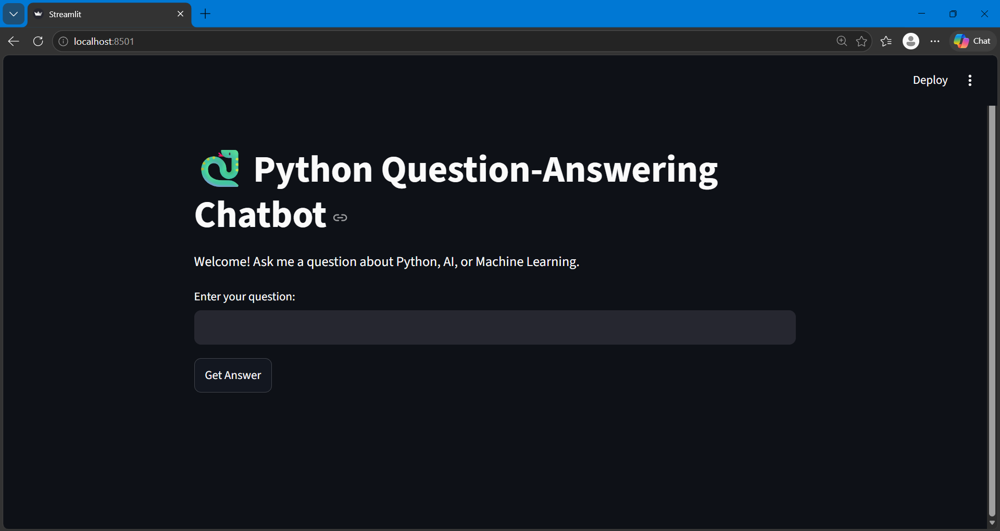
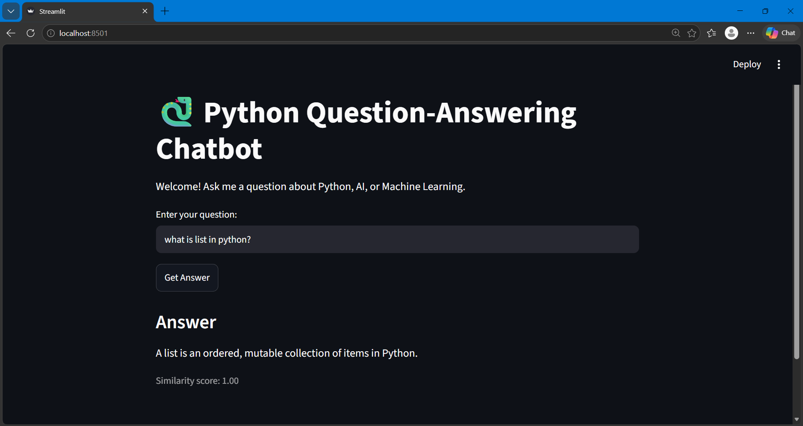

# Python Question-Answering Chatbot

A simple chatbot that answers beginner questions about Python, AI and Machine Learning. It uses TF-IDF and cosine similarity to find the stored question closest to the user's question, and returns its answer with a similarity score.

## Features
- Answers questions on Python basics, AI, machine learning and data science
- Shows a similarity score with each answer
- Says "Sorry, I don't know" when the question is unrelated (threshold 0.70)
- Simple web interface built with Streamlit

## How it works
1. A knowledge base of 15 question-answer pairs is stored in `chatbot.py`.
2. The stored questions are converted into TF-IDF vectors with scikit-learn.
3. The user's question is converted the same way, and cosine similarity finds the best match.
4. If the score is below 0.70, or the question shares no meaningful word with the best match, the bot declines to answer. Otherwise it returns the matching answer.

## Tech stack
Python, Streamlit, scikit-learn (TF-IDF, cosine similarity), NumPy

## Setup
```
python -m venv .venv
.venv\Scripts\activate
pip install -r requirements.txt
streamlit run app.py
```
The app opens at `http://localhost:8501`.

## Project structure
```
app.py             Streamlit interface
chatbot.py         Knowledge base and answer-matching logic
requirements.txt   Dependencies
```

## Screenshots

**Home page**



**Answer to a Python question**



**Answer to a machine learning question**


**Unrelated question handled safely**


## Limitations
- The knowledge base is small (15 questions), so only closely related questions get answers.
- It matches on word similarity, so it does not understand meaning or rephrased questions well.
- Future improvement: a larger knowledge base and semantic embeddings (for example SBERT).